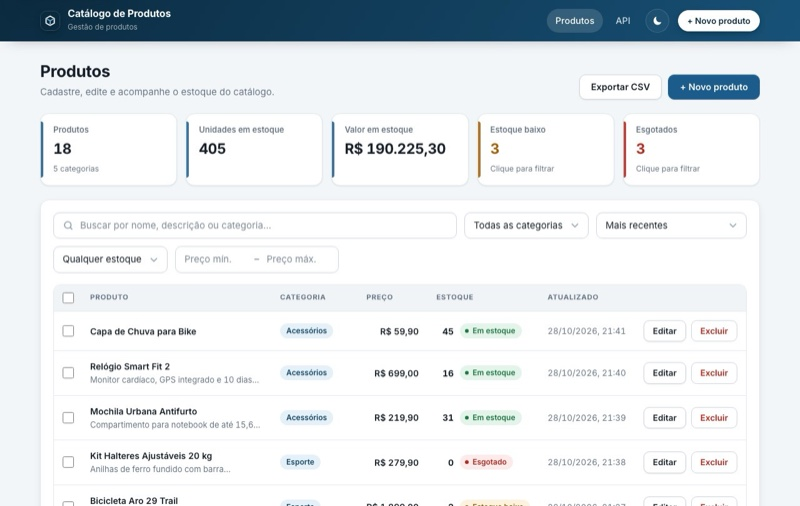
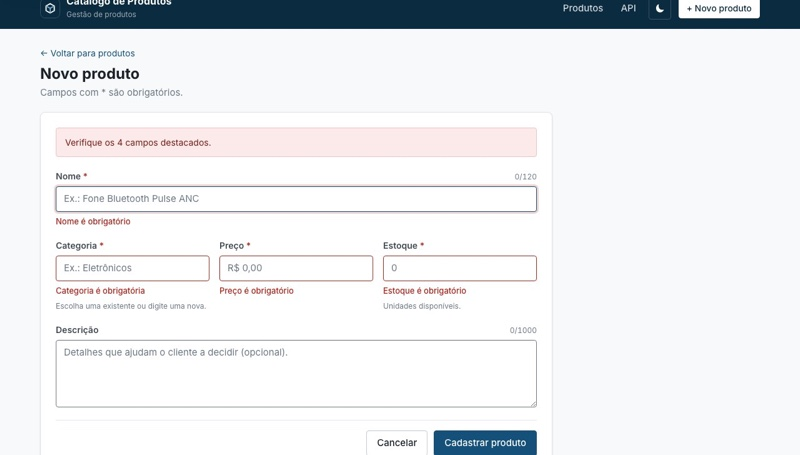
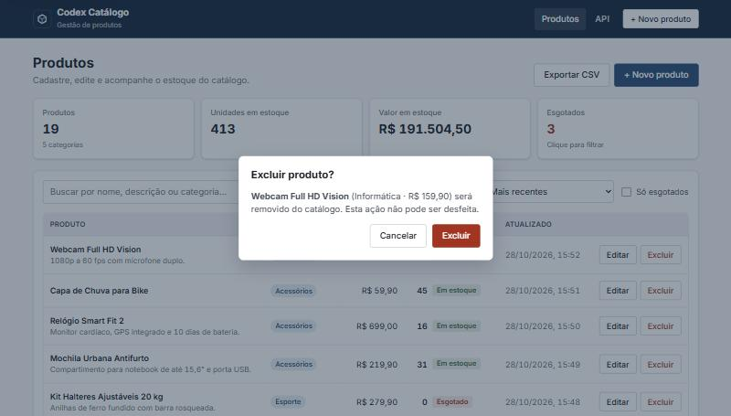
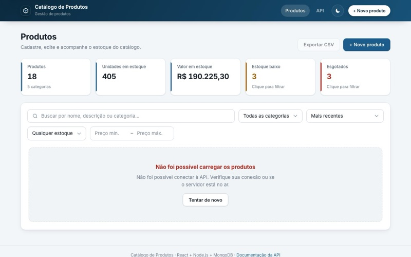

# Catálogo de Produtos — Gerenciamento de Catálogo

Aplicação fullstack para o vendedor gerenciar o catálogo de produtos: **API REST em Node.js (Express 5) + MongoDB (Mongoose)** e **frontend em React 18 + TypeScript (Vite)**.

Solução do desafio técnico [`occ-react-node`](https://gitlab.com/lighthouseit/testes-tecnicos/occ-react-node).



| Validação no formulário | Confirmação de exclusão | Erro de conexão |
| :---: | :---: | :---: |
|  |  |  |

---

## Sumário

1. [Checklist do desafio](#1-checklist-do-desafio)
2. [Guia de execução](#2-guia-de-execução)
3. [Variáveis de ambiente](#3-variáveis-de-ambiente)
4. [Documentação da API](#4-documentação-da-api)
5. [Decisões técnicas](#5-decisões-técnicas)
6. [Estrutura de pastas](#6-estrutura-de-pastas)
7. [Testes](#7-testes)
8. [Além do pedido](#8-além-do-pedido)
9. [Limitações e próximos passos](#9-limitações-e-próximos-passos)

---

## 1. Checklist do desafio

| Requisito | Status | Onde |
| :--- | :---: | :--- |
| **Backend** com Express, Fastify ou NestJS | ✅ | Express 5 — [`backend/src/app.js`](backend/src/app.js) |
| `GET /products` lista todos | ✅ | [`product.router.js`](backend/src/routes/product.router.js) → [`ProductController.getAll`](backend/src/app/controller/ProductController.js) |
| `GET /products/:id` retorna por ID | ✅ | `ProductController.getById` (404 se não existe, 400 se o ID é inválido) |
| `POST /products` cria | ✅ | `ProductController.create` (201 + `Location`) |
| `PUT /products/:id` atualiza | ✅ | `ProductController.update` (200 / 400 / 404 / 412) |
| `DELETE /products/:id` remove | ✅ | `ProductController.remove` (204 / 400 / 404): some na hora de todas as leituras e é apagado do banco após o prazo da lixeira (padrão 10 min), com "Desfazer" até lá |
| `name` obrigatório, 3 a 120 caracteres | ✅ | Joi em [`validation/product.js`](backend/src/app/validation/product.js) + schema Mongoose + testes |
| `price` número positivo maior que 0 | ✅ | idem (também recusa texto, `null` e mais de 2 casas decimais) |
| `stock` inteiro ≥ 0 | ✅ | idem (recusa fracionado e negativo) |
| `category` obrigatória e não vazia | ✅ | idem (recusa vazio e só espaços) |
| Banco **MongoDB via Mongoose** | ✅ | [`ProductSchema.js`](backend/src/app/schema/ProductSchema.js) |
| **Frontend** React: listagem consumindo a API | ✅ | [`pages/ProductList.tsx`](frontend/src/pages/ProductList.tsx) |
| Formulário de criação **e** edição (Nome, Descrição, Preço, Estoque, Categoria) | ✅ | **Um único** [`ProductForm`](frontend/src/components/ProductForm.tsx) usado por [`ProductCreate`](frontend/src/pages/ProductCreate.tsx) e [`ProductEdit`](frontend/src/pages/ProductEdit.tsx) |
| Exclusão com confirmação prévia | ✅ | [`ConfirmDialog`](frontend/src/components/ConfirmDialog.tsx) acessível (`<dialog>` nativo modal, foco no "Cancelar", Esc, Tab preso) |
| Feedback de **Loading** | ✅ | esqueleto na primeira carga, lista esmaecida ao recarregar, botões "Salvando…/Excluindo…", [`Feedback.tsx`](frontend/src/components/Feedback.tsx) |
| Feedback de **Erro** | ✅ | erro por campo, alerta no formulário, bloco "Tentar de novo", erro dentro do diálogo e toasts |
| Organização: Rotas, Controllers, Lógica separados | ✅ | `routes → validation → controller → service → repository → schema` + `rules/` puras |
| HTTP centralizado, `try/catch`, estado sincronizado | ✅ | [`services/api.ts`](frontend/src/services/api.ts) + [`productService.ts`](frontend/src/services/productService.ts) + [`productQueries.ts`](frontend/src/queries/productQueries.ts) |
| Status HTTP corretos e mensagens úteis | ✅ | 200, 201, 204, 400, 404, 412, 413, 500 — [tabela](#códigos-de-status) |
| Reutilização (mesmo formulário para Create/Edit) | ✅ | `ProductForm`, `FormField`, `ConfirmDialog`, `Feedback`, `productQueries` |
| README: guia de execução | ✅ | [seção 2](#2-guia-de-execução) |
| README: decisões técnicas | ✅ | [seção 5](#5-decisões-técnicas) |
| `.env.example` | ✅ | [`backend/.env.example`](backend/.env.example), [`frontend/.env.example`](frontend/.env.example), [`.env.example`](.env.example) (Docker) |
| README: documentação da API | ✅ | [seção 4](#4-documentação-da-api) + Swagger em `/docs` + [coleção Postman](backend/docs/postman_collection.json) |

---

## 2. Guia de execução

> Pré-requisito: **Node.js 22+** (ou só **Docker**, na opção A).

### Opção A — Docker (um comando)

```bash
docker compose up --build
```

- Aplicação (site + API): **http://localhost:4008**
- Documentação interativa da API: **http://localhost:4008/docs**

Sobe dois containers: o MongoDB e a aplicação (o backend serve a API e o build do React no mesmo container e na mesma porta). Na primeira subida o catálogo de demonstração é criado automaticamente.

### Opção B — Local, sem instalar MongoDB

```bash
npm run setup   # instala raiz, backend e frontend e cria os .env a partir dos .env.example
npm run dev     # sobe banco, API e frontend juntos
```

| Serviço | Endereço |
| :--- | :--- |
| Frontend (Vite) | **http://localhost:5181** |
| API | http://localhost:4008 |
| Swagger | http://localhost:4008/docs |
| MongoDB local | `mongodb://127.0.0.1:27022` |

O `npm run setup` só cria `backend/.env` e `frontend/.env` se eles ainda não existirem. O `npm run dev` usa as portas **4008**, **5181** e **27022** (precisam estar livres) e para tudo junto com <kbd>Ctrl</kbd>+<kbd>C</kbd>.

O banco de desenvolvimento roda via [`mongodb-memory-server`](https://github.com/typegoose/mongodb-memory-server) com os dados persistidos em `backend/.localdb` — não é preciso instalar o MongoDB. Na **primeira** execução ele baixa o binário do `mongod` (~70 MB). A API cria o catálogo de demonstração se o banco estiver vazio; para recriá-lo do zero: `npm run seed`.

### Opção C — Com um MongoDB seu (local, Atlas, Docker)

Aponte `MONGO_URL` em `backend/.env` para o seu banco e rode as partes separadamente:

```bash
npm --prefix backend run dev
```

```bash
npm --prefix frontend run dev
```

### Scripts úteis (na raiz)

| Script | O que faz |
| :--- | :--- |
| `npm run setup` | Instala tudo e cria os `.env` (não sobrescreve existentes) |
| `npm run dev` | Banco + API + frontend com recarga automática |
| `npm run seed` | **Apaga** os produtos e recria o catálogo de demonstração |
| `npm test` | Testes do backend (Jest) e do frontend (Vitest) |
| `npm run lint` | ESLint e typecheck (`tsc`) do backend e do frontend |
| `npm run format:check` | Prettier do backend e do frontend |
| `npm run test:api` | Roda a coleção Postman (Newman) contra a API no ar |
| `npm run build` | Build de produção do frontend (em `frontend/dist`) |
| `npm start` | API sem recarga automática, servindo também o build do frontend em http://localhost:4008 (rode `npm run build` antes; precisa do MongoDB no ar — em dev, `npm --prefix backend run db`) |

---

## 3. Variáveis de ambiente

### Backend — [`backend/.env.example`](backend/.env.example)

| Variável | Padrão | Descrição |
| :--- | :--- | :--- |
| `PORT` | `4008` | Porta HTTP da API |
| `NODE_ENV` | `development` | `development`, `production` ou `test` |
| `MONGO_URL` | `mongodb://127.0.0.1:27022/catalogo-produtos` | Conexão do MongoDB. **Obrigatória em produção** (a API não sobe sem ela) |
| `CORS_ORIGIN` | `*` em dev; vazio em produção | Origens liberadas, separadas por vírgula, ou `*`. Vazio = sem CORS (o site é servido pela própria API). Só importa com o frontend em outro domínio |
| `SEED_ON_START` | `true` | Cria o catálogo de demonstração na subida **se a coleção estiver vazia** (nunca apaga nada) |
| `DELETED_RETENTION_MINUTES` | `10` | Prazo da lixeira: minutos até o produto excluído ser apagado **definitivamente** do banco (de 1 a 525600). Mudar o valor atualiza o índice na próxima subida |
| `RATE_LIMIT_WRITES_PER_MINUTE` | `120` | Escritas (`POST`/`PUT`/`DELETE`) aceitas por minuto e por IP; acima disso, `429`. `0` desliga |
| `LOG_LEVEL` | `info` | `fatal`, `error`, `warn`, `info`, `debug`, `trace` ou `silent` |

As variáveis são **validadas na subida** (Joi): um valor inválido (porta que não é número, `MONGO_URL` sem `mongodb://`…) impede a API de subir, com uma mensagem dizendo qual variável corrigir.

### Frontend — [`frontend/.env.example`](frontend/.env.example)

| Variável | Padrão | Descrição |
| :--- | :--- | :--- |
| `VITE_API_URL` | *(vazio)* | URL base da API. Vazio = mesmo host do site (proxy do Vite em dev; o backend serve o site em produção) |
| `VITE_PROXY_TARGET` | `http://localhost:4008` | Só no servidor de dev: para onde o Vite encaminha `/products`, `/categories`, `/docs` e `/health` |

### Docker Compose — [`.env.example`](.env.example)

| Variável | Padrão | Descrição |
| :--- | :--- | :--- |
| `APP_PORT` | `4008` | Porta do host onde a aplicação fica exposta |
| `CORS_ORIGIN` | *(vazio)* | Repassada para a API; vazio = sem CORS, já que o site e a API ficam no mesmo domínio |
| `SEED_ON_START` | `true` | Repassada para a API |
| `DELETED_RETENTION_MINUTES` | `10` | Repassada para a API (prazo da lixeira) |

---

## 4. Documentação da API

- **Swagger UI:** `http://localhost:4008/docs` (gerado a partir do contrato [`backend/docs/openapi.yaml`](backend/docs/openapi.yaml), escrito antes do código)
- **OpenAPI em JSON:** `http://localhost:4008/docs/openapi.json`
- **Coleção Postman** com testes automáticos de todo o fluxo: [`backend/docs/postman_collection.json`](backend/docs/postman_collection.json) — importe no Postman ou rode `npm run test:api`

### Endpoints

| Método | Rota | Descrição | Sucesso | Erros |
| :--- | :--- | :--- | :---: | :--- |
| `GET` | `/products` | Lista todos os produtos | `200` | `400` (parâmetro inválido) |
| `GET` | `/products/:id` | Retorna um produto por ID | `200` | `400`, `404` |
| `POST` | `/products` | Cria um produto | `201` | `400` |
| `PUT` | `/products/:id` | Atualiza um produto (substituição completa) | `200` | `400`, `404`, `412` |
| `DELETE` | `/products/:id` | Remove um produto (some na hora; apagado do banco após o prazo da lixeira) | `204` | `400`, `404` |
| `POST` | `/products/:id/restore` | Desfaz a exclusão, dentro do prazo da lixeira *(extra)* | `200` | `400`, `404` |
| `POST` | `/products/batch/delete` | Exclui vários produtos `{ ids }` *(extra)* | `200` | `400` |
| `POST` | `/products/batch/restore` | Restaura vários produtos `{ ids }` *(extra)* | `200` | `400` |
| `POST` | `/products/batch/category` | Muda a categoria de vários `{ ids, category }` *(extra)* | `200` | `400` |
| `GET` | `/categories` | Resumo por categoria *(extra)* | `200` | — |
| `GET` | `/health` | Health check *(extra)* | `200` | `503` (sem conexão com o MongoDB) |

As rotas ficam **exatamente** como no enunciado (`/products`, sem prefixo `/api`).

### Produto

```json
{
  "id": "6720c1f4a2b9d43c8e1f0a11",
  "name": "Fone Bluetooth Pulse ANC",
  "description": "Cancelamento de ruído ativo e 30h de bateria.",
  "price": 349.9,
  "stock": 25,
  "category": "Eletrônicos",
  "inStock": true,
  "version": 1,
  "createdAt": "2026-10-28T18:51:05.343Z",
  "updatedAt": "2026-10-28T18:51:05.343Z"
}
```

| Campo | Entrada | Regra |
| :--- | :---: | :--- |
| `name` | obrigatório | texto de **3 a 120** caracteres (contados sem os espaços das pontas) |
| `description` | opcional | texto até 1000 caracteres |
| `price` | obrigatório | **número > 0**, no máximo 2 casas decimais, até 999.999.999,99 |
| `stock` | obrigatório | **inteiro ≥ 0**, até 999.999.999 |
| `category` | obrigatório | texto **não vazio**, até 60 caracteres |
| `id`, `inStock`, `version`, `createdAt`, `updatedAt` | — | gerados pela API (se enviados, são ignorados) |

Números precisam chegar como **número JSON**: `"10.50"` (texto) é recusado com mensagem clara, em vez de convertido em silêncio.

### Parâmetros opcionais de `GET /products`

Sem parâmetros, a rota devolve **todos** os produtos (mais recentes primeiro), como pede o desafio. Os parâmetros são opcionais e combináveis:

| Parâmetro | Exemplo | Efeito |
| :--- | :--- | :--- |
| `search` | `?search=fone` | Busca em nome, descrição e categoria (sem diferenciar maiúsculas) |
| `category` | `?category=eletrônicos` | Categoria exata, sem diferenciar maiúsculas |
| `inStock` | `?inStock=false` | `true` só com estoque, `false` só esgotados |
| `stockStatus` | `?stockStatus=low` | Faixa de estoque: `out` (0), `low` (1 a 5) ou `ok` (acima de 5); prevalece sobre `inStock` |
| `minPrice`, `maxPrice` | `?minPrice=100&maxPrice=500` | Faixa de preço, limites inclusivos (`maxPrice` ≥ `minPrice`) |
| `sort` | `?sort=-price` | `name`, `price`, `stock`, `createdAt`, `updatedAt`; prefixo `-` inverte |
| `page`, `limit` | `?page=2&limit=10` | Paginação (limit de 1 a 100) |

A resposta é **sempre uma lista**; o total que atende aos filtros vem no cabeçalho **`X-Total-Count`** — paginar não muda o formato do corpo.

### Concorrência otimista (`ETag` / `If-Match`) — opcional

`GET /products/:id`, `POST` e `PUT` devolvem `ETag: "<versão>"`. Enviando esse valor em `If-Match` no `PUT`, a API só grava se ninguém tiver alterado o produto nesse meio-tempo; caso contrário responde **`412 Precondition Failed`** com a `currentVersion`. Sem o cabeçalho, a última gravação vence (comportamento REST padrão). O frontend usa isso para avisar o vendedor em vez de sobrescrever a alteração de outra pessoa.

### Exclusão com lixeira e operações em lote

`DELETE /products/:id` responde `204` e o produto some **na hora** de todas as leituras (listagem, `GET /products/:id`, resumo por categoria, edição). Ele vai para uma lixeira (`deletedAt` preenchido) e é **apagado definitivamente do banco** depois de `DELETED_RETENTION_MINUTES` (padrão **10 minutos**) por um índice TTL do MongoDB — o mesmo mecanismo nativo que expira sessões, sem job nem cron na aplicação. O MongoDB verifica os vencidos a cada 60 segundos, então com o padrão o registro sai do banco em até ~11 minutos.

Até lá, `POST /products/:id/restore` desfaz a exclusão e devolve o produto como estava — é o "Desfazer" do frontend, que fica 8 segundos na tela. Depois do prazo, a restauração responde `404`. Se, enquanto ele estava excluído, a categoria passou a ser gravada com outra capitalização ("eletrônicos" × "Eletrônicos"), o produto restaurado adota a grafia atual, para o catálogo não se fragmentar.

O índice é **parcial** (só contém documentos com `deletedAt` do tipo data), então os produtos ativos (`deletedAt: null`) nunca expiram e não ocupam espaço nele. Ele é garantido pela API a cada subida ([`ProductRepository.ensureTrashExpiration`](backend/src/app/repository/ProductRepository.js)): cria se não existe e, se o prazo configurado mudou, ajusta com `collMod` — o MongoDB não aceita recriar um índice TTL com outro prazo.

As rotas `/products/batch/*` recebem até **100 ids** únicos. Ids inexistentes ou já excluídos são ignorados, e a resposta diz quantos foram afetados (`{ "deleted": 3 }`, `{ "restored": 3 }`, `{ "updated": 2, "category": "Cozinha" }`). A mudança de categoria em lote aplica a mesma normalização da gravação individual e incrementa a versão de cada produto, então quem estava editando um deles recebe `412` ao salvar.

### Formato de erro

Todo erro tem o mesmo corpo, com mensagens em português prontas para a tela:

```json
{
  "statusCode": 400,
  "error": "Bad Request",
  "message": "Verifique os campos destacados.",
  "details": [
    { "field": "name", "message": "Nome deve ter pelo menos 3 caracteres" },
    { "field": "price", "message": "Preço deve ser maior que zero" }
  ]
}
```

`details` aparece nos erros de validação (um item por campo, **todos de uma vez**). Erros inesperados respondem `500` com mensagem genérica — o detalhe técnico fica só no log do servidor.

### Códigos de status

| Código | Quando |
| :---: | :--- |
| `200` | Leitura, atualização, restauração ou operação em lote bem-sucedida |
| `201` | Produto criado (com cabeçalho `Location: /products/:id`) |
| `204` | Produto removido (sem corpo) |
| `400` | Corpo inválido, JSON malformado, ID fora do formato, parâmetro de listagem inválido ou `If-Match` ilegível |
| `404` | Produto inexistente, ou rota desconhecida da API |
| `412` | `If-Match` com versão desatualizada |
| `413` | Corpo maior que 100 KB |
| `429` | Limite de escritas por minuto excedido (`RATE_LIMIT_WRITES_PER_MINUTE`) |
| `503` | `/health` sem conexão com o MongoDB (o healthcheck do Docker acusa) |
| `500` | Erro inesperado |

### Exemplos com `curl`

```bash
curl -i -X POST http://localhost:4008/products -H "Content-Type: application/json" -d '{"name":"Fone Bluetooth","price":349.9,"stock":25,"category":"Eletrônicos"}'
```

```bash
curl -i "http://localhost:4008/products?search=fone&sort=-price&page=1&limit=10"
```

```bash
curl -i -X PUT http://localhost:4008/products/<id> -H "Content-Type: application/json" -H 'If-Match: "1"' -d '{"name":"Fone Bluetooth 2","price":299.9,"stock":10,"category":"Eletrônicos"}'
```

```bash
curl -i -X DELETE http://localhost:4008/products/<id>
curl -i -X POST http://localhost:4008/products/<id>/restore
```

```bash
curl -i -X POST http://localhost:4008/products/batch/category -H "Content-Type: application/json" -d '{"ids":["<id1>","<id2>"],"category":"Cozinha"}'
```

---

## 5. Decisões técnicas

### Stack

| Camada | Escolha | Por quê |
| :--- | :--- | :--- |
| API | **Express 5** | O Express 5 já propaga erro de handler assíncrono e tem roteamento mais estrito |
| Banco | **MongoDB + Mongoose 8** | Opção permitida pelo desafio; collation `pt` resolve ordenação e comparação sem diferenciar maiúsculas |
| Validação | **Joi** | Esquema declarativo, todas as mensagens em um lugar, conversão/limpeza do corpo (`stripUnknown`) |
| Frontend | **React 18 + TypeScript + Vite + React Router 6 + axios + Sass** | TypeScript estrito com os tipos do domínio num lugar só ([`types/`](frontend/src/types)) |
| Dados no frontend | **TanStack Query 5** | Cache, cancelamento, nova tentativa e invalidação depois de cada escrita, sem estado global à mão |
| Formulário | **react-hook-form + zod** | Validação declarativa com as mesmas mensagens do Joi; a saída do esquema já é o corpo da requisição |
| Qualidade | **ESLint + Prettier nos dois lados; TypeScript no frontend e `checkJs` (JSDoc) no backend** | Frontend com lint por tipos e acessibilidade (typescript-eslint, react-hooks, jsx-a11y); backend com os tipos de Express, Mongoose e Joi conferidos pelo `tsc` sem reescrever em TS; formatação e cobertura mínima conferidas no CI |
| Testes | **Jest + Supertest + mongodb-memory-server** / **Vitest + Testing Library** | Testes de integração com MongoDB real em memória, sem mocks de banco |
| Entrega | **Docker multi-stage + Compose** | Um container serve API e site: um serviço, um domínio, sem CORS |

### Arquitetura do backend

```text
HTTP ─▶ routes ─▶ validation ─▶ controller ─▶ service ─▶ repository ─▶ schema (Mongoose) ─▶ MongoDB
         │          (Joi, ID)     (HTTP ↔      (regra de    (consultas)
         │                         domínio)     negócio)
         └─ docs (Swagger)                         │
                                                   └─▶ rules/  funções puras, sem banco nem Express
```

- **routes** só ligam URL → middlewares → controller.
- **validation** responde `400` antes de qualquer acesso ao banco (corpo, query e formato do ID).
- **controller** é fino: traduz HTTP (status, `Location`, `ETag`, `X-Total-Count`) e tem `try/catch` em cada método. O Express 5 já repassaria o erro de um handler `async` ao tratador central, mas o `try/catch` fica explícito porque o desafio pede. Todos os erros esperados herdam de `HttpError` (`BadRequest`, `NotFound`, `RouteNotFound`, `PreconditionFailed`, `PayloadTooLarge`) e saem por uma única função, `respondWithError`, com o mesmo corpo; qualquer outro erro vira `500` sem vazar detalhes.
- **Dependências injetadas**: o service recebe o repositório e os controllers recebem o service pelo construtor (com a instância padrão como valor default), então dá para testar o service com um repositório falso, sem banco.
- **Inicialização explícita**: o `app.js` só monta o Express; quem conecta ao banco, sobe o servidor e encerra no `SIGTERM` é o `server.js`.
- **service** concentra a regra: normalização do texto, reaproveitamento da grafia da categoria, decisão entre `404` e `412`.
- **repository** isola o Mongoose (filtros, collation, paginação, agregação) e sempre devolve objetos simples (`lean`), nunca documentos do Mongoose.
- **rules/** são funções puras (limites, normalização, ordenação, parsing de `If-Match`) — testadas sem banco e lidas pela validação, pelo schema e pelo service, então um limite muda num lugar só.

### Validação em três camadas, com papéis diferentes

1. **Frontend** ([`productSchema.ts`](frontend/src/schemas/productSchema.ts), zod) — UX: o erro aparece ao sair do campo, sem ida ao servidor. Espelha as mensagens da API, com os limites de [`productRules.ts`](frontend/src/utils/productRules.ts).
2. **Joi na API** — o contrato: é a autoridade. Devolve **todos** os campos inválidos de uma vez, com `field` e `message`.
3. **Schema Mongoose** — última linha de defesa: nenhum caminho que escreva no banco (seed, script, código futuro) grava produto inválido.

Quando a API recusa algo que passou no cliente, o formulário mostra a mensagem **embaixo do campo certo**, igual à validação local.

### Decisões de domínio

- **`PUT` é substituição completa** — por isso o mesmo esquema Joi serve para criar e atualizar, e o **mesmo formulário** serve para as duas telas.
- **Dinheiro com no máximo 2 casas decimais, guardado em centavos.** `10.999` é recusado. No banco o preço é um inteiro (`priceCents`), então somas como o valor em estoque não acumulam erro de ponto flutuante; a API continua recebendo e devolvendo `price` em reais. Bancos com o formato antigo (`price` em reais) são convertidos automaticamente na subida. No frontend, o campo de preço é estilo "caixa eletrônico" (dígitos entram pelos centavos: `1999` → `R$ 19,99`), evitando os problemas de vírgula/ponto e notação científica do `<input type="number">`.
- **Categoria é texto livre, mas não fragmenta**: se "Eletrônicos" já existe, criar com "ELETRÔNICOS" reaproveita a grafia existente. Na edição, o próprio produto fica fora dessa busca para poder corrigir a capitalização de uma categoria que só ele usa.
- **Espaços normalizados**: `"  Mouse   sem fio "` vira `"Mouse sem fio"`; o mínimo de 3 caracteres conta sem os espaços das pontas.
- **ID inválido é `400`, ID inexistente é `404`.** Um ID fora do formato nunca vai existir, e responder antes de ir ao banco evita expor um `CastError`.
- **Concorrência otimista** com versão própria (o `__v` do Mongoose só incrementa quando um array muda). Checagem e escrita são **uma operação atômica** (`findOneAndUpdate` filtrando pela versão).
- **Rotas exatamente como no enunciado** (`/products`); as rotas do site ficam em português (`/produtos/novo`) para o mesmo servidor entregar API e SPA sem colisão. Uma sub-rota desconhecida da API responde `404` em JSON, nunca o HTML do site.
- **Corpo de erro** `{ statusCode, error, message, details }`. Sem `name` na raiz: `name` é campo do produto, e repetir a chave no erro confundiria quem consome a API.

### Segurança e operação

- **CSP ligada** (Helmet): scripts só do próprio domínio; o único script inline do site (o que aplica o tema antes da primeira pintura) é liberado pelo **hash**, calculado na subida a partir do `index.html` do build.
- **CORS fechado por padrão em produção**: o site é servido pela própria API, então não precisa de CORS; `CORS_ORIGIN` libera origens quando o frontend fica em outro domínio.
- **Limite de escritas** por IP (`express-rate-limit`), com os cabeçalhos `RateLimit` padrão; leituras não são limitadas.
- **Logs estruturados** com pino: JSON em produção, uma linha legível em desenvolvimento. Cada requisição ganha um `X-Request-Id` (ou reaproveita o recebido), que aparece no log e na resposta.
- **Índices compostos** começando por `deletedAt`, para as consultas de produtos ativos ordenadas por data, por categoria e por preço, e um **índice TTL parcial** em `deletedAt` que esvazia a lixeira sozinho.
- **Health check** responde `503` sem banco (o healthcheck do Docker acusa) e o servidor **encerra graciosamente** no `SIGTERM`.

### Frontend

- **TypeScript estrito** (`strict`, `noUncheckedIndexedAccess`): o formato público da API mora em [`types/product.ts`](frontend/src/types/product.ts) e é a única definição de `Product`, `ProductInput`, filtros e resumo por categoria usada por services, queries, componentes e testes. O `state` trocado entre listagem e formulários também é tipado ([`types/navigation.ts`](frontend/src/types/navigation.ts)) e lido com validação.
- **Chamadas HTTP centralizadas**: só [`services/productService.ts`](frontend/src/services/productService.ts) conhece as rotas; páginas nunca importam o axios. O [`services/api.ts`](frontend/src/services/api.ts) converte **qualquer** falha (validação, 404, 412, rede, timeout, cancelamento) num `ApiError` com mensagem pronta e `fieldErrors` por campo — e é esse o tipo de erro registrado no React Query, então `error.status` e `error.message` já chegam tipados nas telas.
- **Dados com TanStack Query** ([`queries/productQueries.ts`](frontend/src/queries/productQueries.ts)): cada leitura tem uma chave hierárquica (`['products', 'list', filtros]`, `['products', 'detail', id]`, `['categories']`). A requisição anterior é **cancelada** quando os filtros mudam (digitar na busca não deixa uma resposta velha sobrescrever a nova), os dados anteriores ficam na tela esmaecidos enquanto os novos chegam, e as categorias são buscadas uma vez para indicadores, filtro e sugestões do formulário. Só rede, timeout e 5xx ganham uma nova tentativa automática; 4xx nunca se repete.
- **Sincronização do estado**: depois de criar, editar ou excluir, as mutations **invalidam** listas e indicadores (o servidor é a fonte da verdade) e gravam o produto salvo no cache; o item volta destacado na lista. Excluir o último item de uma página volta para a página anterior; excluir algo que outra pessoa já excluiu (`404`) é tratado como sucesso. A edição sempre confere o servidor ao abrir (a versão importa para o `If-Match`) e não recarrega sozinha no meio da digitação.
- **Formulário com react-hook-form + zod**: o esquema ([`productSchema.ts`](frontend/src/schemas/productSchema.ts)) valida com as mesmas mensagens da API e sua saída já é o corpo da requisição (texto normalizado, estoque em número). Valida ao sair do campo e, depois, a cada tecla; o foco vai para o primeiro campo inválido; erros por campo vindos da API aparecem no campo certo.
- **Alterações não salvas**: com o roteador de dados, o `useBlocker` pede confirmação em qualquer saída do formulário — Cancelar, "← Voltar", links do topo e o voltar do navegador — e o `beforeunload` cobre fechar/recarregar a aba.
- **Estado na URL**: busca, categoria, faixa de estoque, faixa de preço, ordenação, página e itens por página ficam na query string (`/?busca=fone&estoque=baixo&ordem=-price`) — recarregar, voltar no navegador ou compartilhar o link mostra a mesma lista. A lógica fica em [`useProductFilters`](frontend/src/hooks/useProductFilters.ts); exclusão, seleção, ações em lote e exportação também saíram da página para hooks próprios (`useProductDeletion`, `useProductSelection`, `useBulkActions`, `useCsvExport`).
- **Carregamento sob demanda**: as telas de formulário (com zod e react-hook-form) ficam num pacote separado, baixado só ao abrir o formulário; a listagem não carrega esse código.
- **Acessibilidade**: rótulos ligados aos campos, `aria-invalid` + `aria-describedby` nos erros, foco no primeiro campo inválido, diálogo com `<dialog>` nativo (o resto da página fica inerte) com foco no botão seguro e Tab preso, **foco no título da página e título da aba a cada troca de tela**, rolagem restaurada, toasts em região `aria-live`, link "pular para o conteúdo", estado de estoque com texto (não só cor) e `prefers-reduced-motion`. O `eslint-plugin-jsx-a11y` confere a marcação no CI.
- **Visual**: cores definidas como tokens nomeados pela função (`--fundo`, `--primaria`, `--texto`…), **tema escuro** que segue o sistema operacional e pode ser alternado no topo (só os tokens mudam), fonte Inter servida pelo próprio app (sem Google Fonts), números tabulares; no celular a tabela vira cartões só com CSS.

### Convenção de nomes no frontend

| O quê | Idioma | Exemplos |
| :--- | :--- | :--- |
| O que é exportado: componentes, hooks, funções, tipos, props e campos de objetos compartilhados | **Inglês** | `ProductForm`, `useProductFilters`, `formatCurrency`, `ErrorState`, `onRetry`, `returnTo` |
| Variáveis e funções locais, comentários | Português | `voltarPara`, `marcarPrimeiroInvalido` |
| Texto da interface, mensagens de erro, classes CSS, parâmetros da URL | Português | `botao--primario`, `?busca=&pagina=` |

A fronteira é o `export`: quem importa um módulo lê uma API em inglês, como a da API REST (`name`, `price`, `stock`); o que o usuário vê — tela, endereço, CSS — fica em português.

---

## 6. Estrutura de pastas

```text
.
├── backend/
│   ├── docs/
│   │   ├── openapi.yaml              # contrato da API (servido em /docs)
│   │   └── postman_collection.json   # fluxo completo com testes (Newman)
│   ├── eslint.config.js              # ESLint + Prettier
│   ├── tsconfig.json                 # checkJs: tipos conferidos nos .js via JSDoc
│   ├── scripts/                      # db local (mongodb-memory-server) e seed
│   ├── __tests__/                    # Jest + Supertest (MongoDB em memória)
│   └── src/
│       ├── app.js                    # middlewares, rotas, 404, SPA, erros
│       ├── server.js
│       ├── routes/                   # product, category, docs
│       ├── infra/                    # conexão Mongo (com nova tentativa) e seed
│       └── app/
│           ├── config/               # leitura do .env
│           ├── controller/           # HTTP ↔ service
│           ├── service/              # regra de negócio
│           ├── repository/           # acesso ao Mongo (Generic + Product)
│           ├── schema/               # Mongoose
│           ├── validation/           # Joi + middleware + ID
│           ├── rules/                # funções puras do domínio
│           ├── serialize/            # formato público do produto e dos erros
│           ├── errors/               # HttpError e subclasses (400, 404, 412, 413)
│           └── helpers/              # logger (pino), log de requisições e respondWithError
├── frontend/
│   ├── eslint.config.js              # typescript-eslint + react-hooks + jsx-a11y + Prettier
│   ├── tsconfig.json                 # app e testes (tsconfig.node.json: vite.config.ts)
│   └── src/
│       ├── types/                    # Product, ProductInput, filtros, state de navegação
│       ├── services/                 # api.ts (axios + ApiError) e productService.ts
│       ├── queries/                  # React Query: cliente e queries/mutations do catálogo
│       ├── schemas/                  # productSchema.ts (zod, mesmas mensagens do Joi)
│       ├── hooks/                    # useProductFilters, useProductDeletion, useCsvExport, useDocumentTitle…
│       ├── components/               # ProductForm, ProductTable, ConfirmDialog, FormField, Feedback…
│       ├── pages/                    # ProductList, ProductCreate, ProductEdit, NotFound
│       ├── context/                  # ToastContext (provider) e toast.ts (useToast)
│       ├── utils/                    # limites do produto, formatação, CSV
│       ├── styles/                   # main.scss (tokens de cor, tema claro e escuro)
│       ├── test/                     # setup do Vitest e renderWithProviders
│       ├── routes.tsx                # rotas (formulários sob demanda)
│       └── __tests__/                # Vitest + Testing Library
├── docs/screenshots/
├── scripts/env.js                    # cria os .env no npm run setup
├── .env.example                      # variáveis do docker-compose.yml
├── Dockerfile                        # multi-stage: build do React + runtime da API
├── docker-compose.yml                # app + mongo
├── .github/workflows/ci.yml          # testes, lint, build e imagem Docker (GitHub Actions)
└── .gitlab-ci.yml                    # testes, lint e build no GitLab
```

---

## 7. Testes

```bash
npm test            # backend + frontend
npm run test:api    # coleção Postman contra a API no ar (npm run dev antes)
```

| Suíte | Ferramentas | Quantidade | Cobre |
| :--- | :--- | :---: | :--- |
| Backend | Jest + Supertest + mongodb-memory-server | **139** | Cada endpoint e status; cada regra de negócio nos limites (2/3/120/121 caracteres, `0`, `0.01`, `-1`, `1.5`, texto, `null`, só espaços); busca, filtros (faixa de estoque e de preço), ordenação com acento, paginação; `If-Match`/`412`; exclusão lógica e restauração (inclusive a grafia da categoria); lixeira com expiração (índice TTL parcial criado e ajustado, e o produto excluído apagado de verdade do banco num `mongod` com o monitor TTL acelerado); operações em lote (validação, limite de 100, grafia da categoria); JSON malformado; rota desconhecida; health com `503`; preço em centavos e migração do formato antigo; configuração validada; CSP, `X-Request-Id` e limite de escritas (`429`); service com repositório falso; resumo por categoria; funções puras |
| Frontend | Vitest + Testing Library | **73** | Esquema zod (mesmos casos da API); `ApiError` para cada tipo de falha; `ProductForm` criando e editando, erro da API no campo certo, estado de envio, descarte com confirmação no Cancelar, no voltar do navegador e nenhuma depois de salvar; `ConfirmDialog` (foco, Esc, Tab, clique no fundo, ocupado); `ProductList` com carregando, erro + tentar de novo, vazio, exclusão confirmada/cancelada/falhando, desfazer exclusão, busca com debounce, filtros de estoque e preço, tamanho da página, atalho `/` e ações em lote (seleção, excluir com desfazer, mudar categoria, exportar selecionados); `Layout` com atalho `N` e alternância de tema |
| Contrato | Postman / Newman | **15 req. / 17 asserções** | Fluxo ponta a ponta contra a API real: criar → listar → buscar → atualizar → conflito → remover → 404 |

O CI ([GitHub Actions](.github/workflows/ci.yml) e [GitLab CI](.gitlab-ci.yml)) roda, nos dois lados, Prettier (`format:check`), ESLint, o typecheck (`tsc`) e os testes. No backend os testes rodam com cobertura e **falham abaixo da meta** (88% de instruções e linhas, 80% de desvios, 85% de funções — hoje em ~90%); no frontend o typecheck roda dentro do build. No GitHub Actions, por fim, a imagem Docker também é construída.

```bash
# em backend/ ou frontend/
npm run lint           # ESLint
npm run typecheck      # tsc, sem emitir (checkJs no backend)
npm run format:check   # Prettier
npm run test:coverage  # só no backend: testes + meta de cobertura
```

---

## 8. Além do pedido

- 🔎 **Busca, filtros por categoria, faixa de estoque (em estoque / baixo / esgotado) e faixa de preço, ordenação e paginação com itens por página configurável** — no servidor, com o estado na URL.
- 📊 **Indicadores do catálogo**: produtos, unidades, valor em estoque, estoque baixo e esgotados (os dois últimos clicáveis para filtrar), via `GET /categories`.
- ↩️ **Desfazer exclusão**: o aviso de "excluído" traz um botão **Desfazer** por alguns segundos; no backend o produto fica numa lixeira que se esvazia sozinha (índice TTL), então o registro não fica para sempre no banco.
- ☑️ **Ações em lote**: seleção múltipla (inclusive a página inteira) para excluir com desfazer, mudar a categoria ou exportar só os selecionados.
- ⌨️ **Atalhos de teclado**: <kbd>/</kbd> foca a busca e <kbd>N</kbd> abre um novo produto (ignorados enquanto se digita num campo ou com um diálogo aberto).
- 🏷️ **Selo de estoque**: "Em estoque", "Estoque baixo" (≤ 5) e "Esgotado".
- 🔒 **Concorrência otimista** (`ETag`/`If-Match` → `412`), com opção de recarregar ou salvar a sua versão.
- 💰 **Campo de preço com máscara BRL** e **sugestões de categoria** (datalist com as existentes).
- 📤 **Exportar CSV** do resultado filtrado ou só dos selecionados (separador `;` e BOM para abrir direto no Excel em português).
- ⚠️ **Aviso de alterações não salvas** em qualquer saída do formulário (Cancelar, "← Voltar", links do topo, botão voltar do navegador) e ao fechar a aba.
- 📚 **Swagger UI** a partir do contrato OpenAPI + **coleção Postman** com testes.
- 🐳 **Docker** em um comando, com healthcheck (que acusa o banco fora do ar), usuário não-root, seed automático e encerramento gracioso no `SIGTERM`.
- 🧪 **212 testes automatizados** + contrato Newman, e **CI** para GitHub e GitLab (com lint, typecheck e formatação).
- 🌙 **Tema escuro**: segue o sistema operacional por padrão e tem botão para alternar no topo; a escolha fica salva no navegador e é aplicada antes da primeira pintura (sem piscar o tema errado).
- 🛡️ CSP com hash do script inline, CORS fechado em produção, limite de escritas por minuto, limite de corpo (100 KB), regex de busca escapada (sem injeção de padrão), configuração validada na subida e mensagens internas que nunca vazam no `500`.
- 📜 Logs estruturados (pino) com `X-Request-Id` por requisição.
- ♿ Acessibilidade e layout responsivo (tabela vira cartões no celular).

---

## 9. Limitações e próximos passos

- **Autenticação/autorização** não fazia parte do escopo; o caminho natural seria JWT com papéis protegendo as rotas de escrita.
- **Lixeira sem tela própria**: depois que o aviso de "Desfazer" some, restaurar um produto só é possível pela API (`POST /products/:id/restore`), e só dentro do prazo da lixeira. Se o prazo crescer (dias, por exemplo), caberia uma tela de lixeira.
- **`GET /products` sem paginação devolve o catálogo inteiro**, como pede o desafio. Em produção caberia um teto ou paginação obrigatória (e streaming na exportação CSV).
- **Limite de escritas em memória**: conta por processo; com várias instâncias, o contador iria para um armazenamento compartilhado (Redis). Atrás de proxy reverso, seria preciso configurar o `trust proxy` do Express para ler o IP real.
- **Busca por regex** atende bem um catálogo de milhares de itens; para volumes maiores, índice de texto ou Atlas Search.
- **Imagens do produto** e **SKU** ficariam como próximos campos do modelo.
